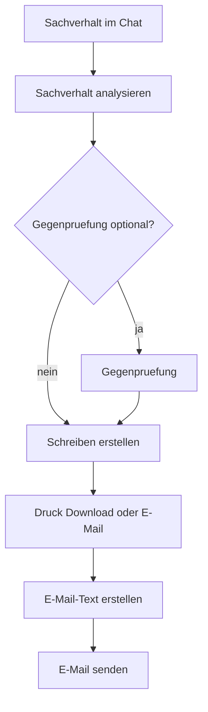

# KI-Chat & vordefinierte Aktionen (Konzept)

Stand: Produktentscheidung Scrinium Ordinis Desk · lebendes Konzept (bei Entscheidungen aktualisieren).  
Noch nicht vollständig umgesetzt — Umsetzung **schrittweise** nach der Reihenfolge unten.

Ziel: Claude-ähnlicher Chat mit **vordefinierten Aktionen** (wie bei Runway: feste Funktion + Prompt/Workflow hinter der API). Desk orchestriert; kein Agent-Framework.

Verwandt: [`ai-pseudonymization.md`](./ai-pseudonymization.md) · Prompt-Bibliothek bleibt **separat** ([`modules/prompts.md`](./modules/prompts.md)).

---

## Zwei Einstiege (Chats)

| Einstieg | Zweck | Daten | Einstieg UI |
|----------|--------|--------|-------------|
| **Freier Chat** | Orientierung, Formulierungen, allgemeiner Dialog | Klartext — **keine** Mandanten-/Falldaten (Disclaimer in UI) | bestehende KI-Card / Route (`/ki`) |
| **Akten-Chat** | Arbeit am Mandat: Analyse, Schreiben, E-Mail | Akte/Mandant; Klartext → **Pseudonym** vor Bedrock | **eigene Card + eigene Route** |

Die Chats sind nur **Orte**. Die Aktionen stehen in **einer** gemeinsamen Liste und werden den Chats zugeordnet.

**Vertragsanalyse** gehört **nicht** zum v1-Konzept (weder Badge noch Workflow in Freier/Akten-Chat). Bestehender Screen `/vertragsanalyse` bleibt vorerst Code-Altlast / Experiment — nicht weiter in dieses Konzept einbauen, bis ausdrücklich reaktiviert.

---

## Vordefinierte Aktionen (eine Liste)

Zwei Arten:

### A) Mit Prompt (LLM)

Hardcodierte System-/User-Prompts im Code (`lib/ai/prompts/…`), Versionierung per Git/Deploy.

| Aktion | Status | Badge v1 | Zuordnung |
|--------|--------|----------|-----------|
| Freier Dialog | live (`/ki`) | — (Chat selbst) | Freier Chat |
| Sachverhalt analysieren | live (`/r/analyse`) | ja | Akten-Chat |
| Gegenprüfung | live | ja (optional) | Akten-Chat |
| Schreiben erstellen | live | ja | Akten-Chat |
| E-Mail-Text erstellen | live | ja | Akten-Chat |

### B) Mit Funktion (Workflow / Desk)

Kein (oder nur optionaler) Prompt — Desk führt aus (Speichern, Versand, Export).

| Aktion | Status | Badge v1 | Zuordnung |
|--------|--------|----------|-----------|
| E-Mail senden | live (SMTP vorhanden) | ja | Akten-Chat |
| Schreiben öffnen / speichern | Letters vorhanden | ja | Akten-Chat |
| Drucken / Download | Letters vorhanden | ja | Akten-Chat |

**Beispiel E-Mail:** Badge „E-Mail-Text erstellen“ (Prompt) → Anwalt prüft → Badge „E-Mail senden“ (Funktion).

### Bewusst nicht in Badge-Leiste / Aktionskatalog v1

- **Vertrag analysieren** (auch nicht zuordnen)
- Verbesserten Vertrag erstellen
- Word-Download als eigener Badge (Export hinter Schreiben / Letters)

---

## UX-Leitlinie

- Claude-Feeling: Start-Composer mittig → nach Absenden unten; User rechts; links „Wird bearbeitet…“
- Über dem Composer: **Badges** nur der Aktionen, die dem jeweiligen Chat zugeordnet sind
- **Freier Chat v1: Badge-Leiste leer** (nur freier Dialog)
- **Akten-Chat v1:** Badges aus der Liste (Prompt + Funktion)
- Akten-Chat: eigene Dashboard-Card und eigene Route (nicht nur Unterseite der Akte)

---

## Prompts & Dev-Übersicht

| Art | Speicher | Wer |
|-----|----------|-----|
| **Produkt-Systemprompts** | Hardcodiert `lib/ai/prompts/` | Produkt / Deploy |
| **Prompt-Bibliothek** | DB | Anwält:innen (eigene Vorlagen) |

**Dev-UI:** `/ai-debug/produkt-ki` — Zugang wie KI-Debug (`AI_DEBUG` + Test-Kanzlei):

- alle **Produkt-Systemprompts** anzeigen (read-only)
- alle **vordefinierten Aktionen** auflisten — Prompt-Aktionen **und** Funktions-Aktionen  
  (nicht die Prompt-Bibliothek)

---

## Platzhalter in Entwürfen

Immer `{{deutsche Bezeichnung}}` (z. B. `{{Gegner}}`, `{{Frist}}`).  
Keine Pseudonym-Tokens (`[PERSON_1]`) und keine freien Lückenformate in Produkt-Entwürfen.

---

## Akten-Chat: Ziel-Workflow (v1)



- **Gegenprüfung:** optionaler zweiter LLM-Lauf; kein Pflicht-Server-Gate vor Schreiben
- Schreiben → bestehendes Letters-Modul: **v1 immer neues Letter** (kein Update bestehender Entwürfe)
- E-Mail → User-SMTP: **v1 Versand aus geprüftem E-Mail-Text im Chat**; Letter als PDF-Anhang optional später
- tenant + practice an allen Persistenz-Punkten

---

## Persistenz: Akte ≈ Claude-Projekt

**Entscheidung:** Akten-Chats sind vollwertig gespeichert und hängen an der Akte — analog Claude „Project“ mit mehreren Chats.

```
Akte (≈ Projekt)
 ├── Chat 1  z. B. „Sachverhalt / Erstanalyse“   → Messages …
 ├── Chat 2  z. B. „Schreiben / Nachbesserung“   → Messages …
 └── Chat n  …
```

| Ebene | Speichert |
|-------|-----------|
| **Akte** | Container (tenant + practice + Mandant/Akte) |
| **Chat** | Thread unter der Akte (Titel, Timestamps, optional Letter-Link) |
| **Message** | Vollständiger Verlauf (User / Assistant, Aktion-Meta) |

**UI:** Akte → Chat-Liste → fortsetzen oder „Neuer Chat“ (nicht ein endloser Einzelthread pro Akte).

| Einstieg | Persistenz |
|----------|------------|
| **Akten-Chat** | DB: `case` → `chats` → `messages` |
| **Freier Chat** | weiter **Session-only** (kein Akte-Bezug) |

**Inhalt der Messages:** das, was der Anwalt sieht (Klartext im Desk). Vor Bedrock weiter Pseudonym-Pipeline; Pseudonym-Map nicht als zweites Dauer-Archiv — nur soweit Jobs/TTL es brauchen.

**Kontext ans Modell (lightweight):** letzte N Turns mitsenden; optionale Chat-Zusammenfassung erst wenn Threads lang werden — kein Vector-/RAG in v1.

**ACL / Löschen:** nur wer die Akte darf, sieht die Chats; Chat einzeln löschbar; mit Akte mitlöschen. Aufbewahrungsfrist später produktseitig festziehen.

**Bewusst nicht v1:** Project-Knowledge-Files, Embedding-Store, Agent-Traces, Chat 1:1 mit Letter vermischen (Letter = Ergebnis; Chat = Arbeitsprotokoll).

---

## Architektur-Prinzipien

- Claude formuliert; Desk orchestriert feste Schritte
- Kein Tool-Calling-Agent
- Akte = Projekt-Container; mehrere vollständige Chats mit Message-Verlauf
- Pseudonym-Pipeline für Akten-Chat (siehe Pseudonymisierungs-Doku)
- Audit content-frei
- ACL über bestehende Functions (`ai-chat`, `case-facts-analysis`, `letters`, …) — `contract-analysis` nicht Teil dieses Konzepts v1

---

## Abgrenzung

| Nicht verwechseln | |
|-------------------|--|
| Prompt-Bibliothek / Prompt-Kit | Anwalts-Vorlagen zum Kopieren — eigene Funktion |
| Freier Chat | Kein Ersatz für Akten-Chat; v1 ohne Badges; keine DB-Persistenz |
| Vertragsanalyse `/vertragsanalyse` | Außerhalb dieses Konzepts bis Reaktivierung |
| Letter | Ergebnis-Dokument; hängt nicht als Chat-Ersatz an der Akte |

---

## Offene Punkte

Derzeit keine. Schreiben/E-Mail-Verhalten v1 siehe Workflow oben; bei Bedarf später nachziehen.

---

## Umsetzungsreihenfolge

1. Konzept aktuell halten (dieses Dokument) — ✅
2. UI-Shell: Freier Chat (ohne Badges) + Akten-Chat (Card, Route, Badge-Leiste; Akte → Chat-Liste) — ✅ Shell live
3. Persistenz-Modell: Chats + Messages an Akte (Schema/Migration) — ✅ `matter_ai_chats` / `matter_ai_chat_messages`
4. Akten-Chat: Sachverhalt analysieren in Chat-Fläche (mit Verlauf) — ✅ Badge + Pseudonym-Gate + Job → Entwurf im Chat
5. Gegenprüfung (optional, Prompt-Aktion) — ✅ Badge + Pseudonym-Gate + Job → Ergebnis im Chat
6. Schreiben erstellen → immer neues Letter — ✅ Badge + Job → neues Letter an Akte + Link im Chat
7. E-Mail-Text + E-Mail senden (aus Chat-Text; SMTP) — ✅ Badge-Text + Versand (Empfänger im Composer)
8. Dev-UI: Produktprompts + Aktionskatalog (Prompt + Funktion) — ✅ `/ai-debug/produkt-ki`

Schritt für Schritt; nach jeder Entscheidung dieses Dokument nachziehen.
